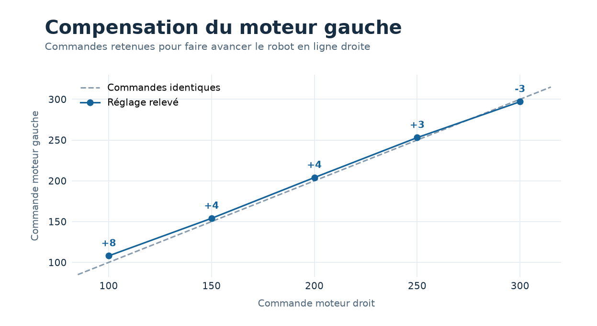
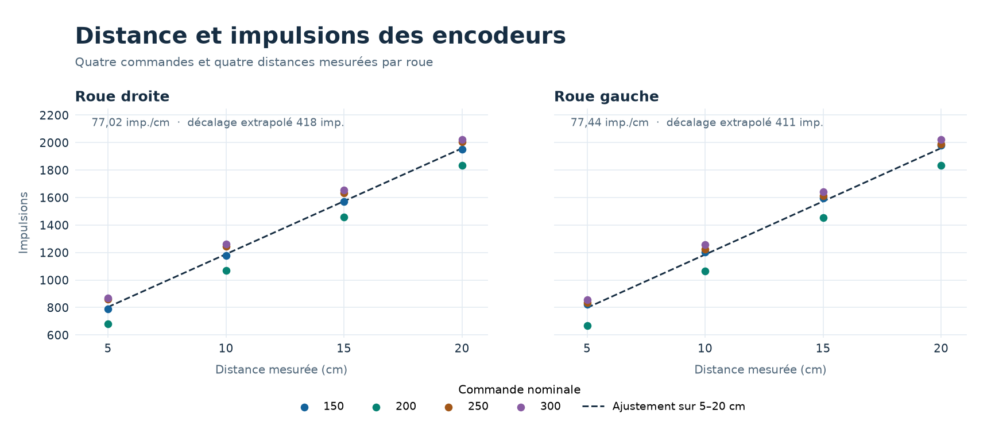
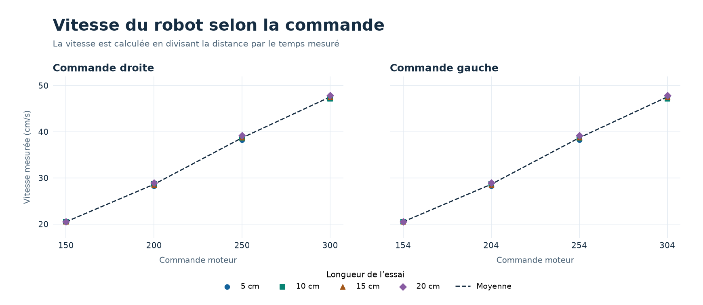

# Robot Zumo et calibration des moteurs

Projet réalisé en binôme à Polytech Paris-Saclay.

## Objectif

Piloter un robot mobile Zumo 32U4, puis mesurer la distance et la vitesse obtenues pour différentes commandes moteur. Nous avons programmé l’acquisition des mesures par liaison série, ajusté les commandes pour avancer en ligne droite et développé une navigation basée sur les capteurs du robot.

## Programmes retrouvés

- Le [programme de calibration](firmware/rendu1/rendu1.ino), adapté du rendu du 11 mars 2025, règle les commandes moteur par liaison série et relève les impulsions des encodeurs et le temps écoulé. Les mesures du classeur accompagnent ce rendu.
- Le [programme de navigation](firmware/RAMOS_TASSAIN_ZUMO_15/RAMOS_TASSAIN_ZUMO_15.ino), adapté de la version de travail du 12 avril 2025, ajoute une machine à états pour le suivi de ligne et le contournement d’obstacles. Elle utilise les capteurs de ligne, les capteurs de proximité et le gyroscope.

## Mesures de calibration

Les cinq tracés du classeur sont regroupés ci-dessous. Les points proviennent des relevés d’origine.

### Compensation des moteurs

Pour une commande de 100 à droite, le réglage relevé est de 108 à gauche. À 300 à droite, le réglage est de 297 à gauche. Les nombres au-dessus des points indiquent l’écart entre les deux commandes. [Mesures](calibration/compensation.csv)

### Distance et encodeurs

Sur les 16 relevés de 5 à 20 cm, les ajustements donnent environ **77 impulsions par centimètre** sur chaque roue, avec des ordonnées à l’origine extrapolées de **418 impulsions à droite** et **411 à gauche**. Cet écart est visible dans les données du rendu. Sa cause reste à vérifier sur le robot, notamment en contrôlant la remise à zéro des compteurs au départ. Les lignes à zéro du classeur sont hors de l’ajustement. [Mesures](calibration/encodeurs.csv)

### Vitesse et commandes

La vitesse du robot est calculée à partir des 16 couples distance–temps. Sa moyenne passe de **20,5 à 47,5 cm/s** entre les couples de commandes 150/154 et 300/304, dans l’ordre droite/gauche. Les deux tracés représentent la même vitesse du robot avec la commande de chaque côté en abscisse. [Mesures](calibration/vitesse.csv)

Pour régénérer les graphiques, lancer `python calibration/trace_calibration.py` avec Python 3.10 ou plus récent et Matplotlib.

## Compilation

Les deux programmes compilent avec Arduino 1.8.13, la carte **Pololu A-Star 32U4** et la bibliothèque **Zumo32U4 1.2.0**.

1. Installer le support de carte Pololu A-Star et la bibliothèque Zumo32U4. [Guide Pololu](https://www.pololu.com/docs/0j63)
2. Copier le dossier [ZumoMotion](firmware/libraries/ZumoMotion) dans le dossier `libraries` du carnet de croquis Arduino.
3. Ouvrir le fichier `.ino` choisi, sélectionner **Pololu A-Star 32U4** et cliquer sur **Vérifier**.

La compilation a été vérifiée sans robot. Les mesures présentées ici viennent des essais d’origine. Le coefficient du gyroscope, les rotations et le comportement de la version actuelle restent à vérifier sur piste.

## Provenance

Les deux programmes partagent une nouvelle implémentation du calcul du cap, des rotations et de l’étalonnage des capteurs de ligne. [Relevé de provenance](PROVENANCE.md)
